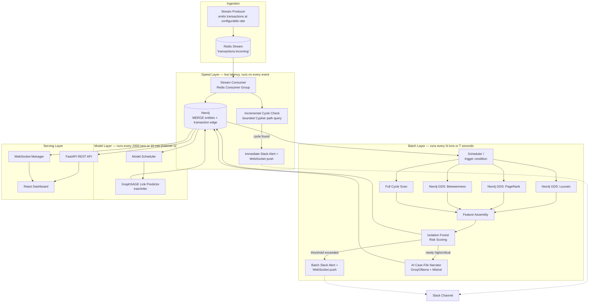
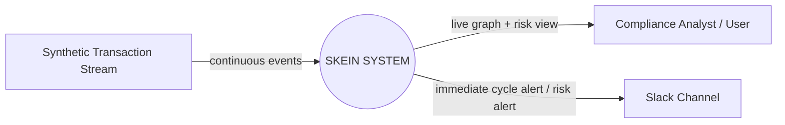
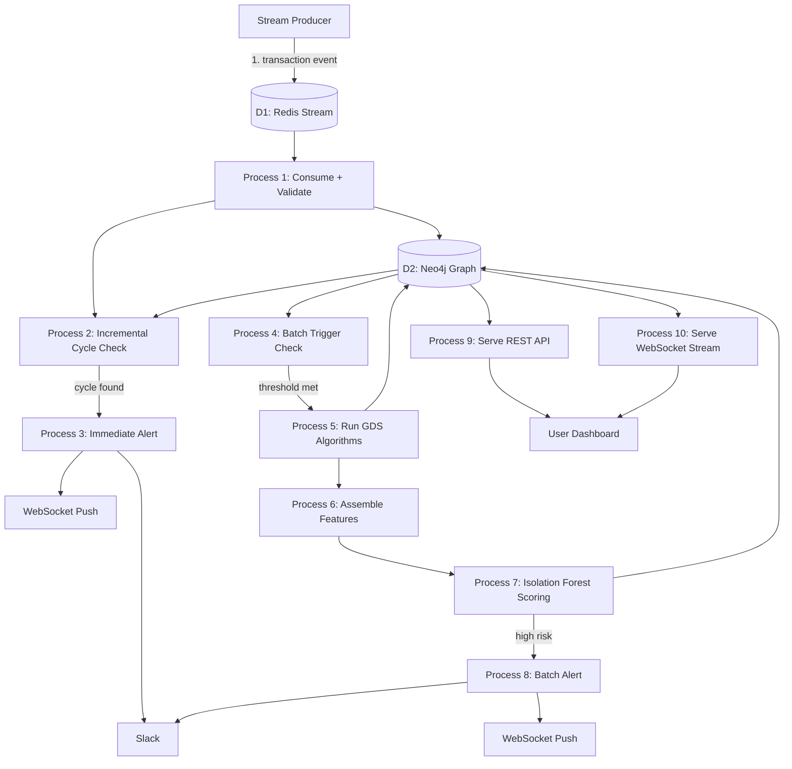
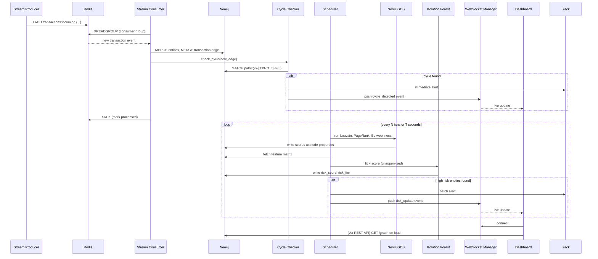

# SKEIN — Real-Time Financial Crime Network Detector
## Complete Technical Specification & Software Requirements Specification (SRS)

**Version:** 3.0 (Neo4j + Streaming + Predictive AI Edition)
**Author:** Navya Rangwani
**Purpose:** Final-year placement portfolio project (Deloitte / Big 4 target)
**Timeline:** 19 days (Phase 1: core system, Days 1–7. Phase 2: real-time + graph DB, Days 8–14. Phase 3: AI narration + predictive graph ML, Days 15–19)
**Document status:** Implementation-ready — every architectural, algorithmic, data, API, and UI decision is finalized. The only remaining work is coding.

**Why "Skein":** A skein is a loop of thread wound so it tangles — and untangling one is exactly what this system does to a money-laundering network. "Layering," the real AML term for threading money through a chain of shell entities to hide its origin, maps directly onto the metaphor. Short, sayable in an interview, and not another "Sentinel/Guardian/Warden" security-tool name that every third resume already has.

---

## TABLE OF CONTENTS

1. Executive Summary
2. Problem Statement
3. Goals & Objectives
4. Scope
5. Stakeholders & User Personas
6. Functional Requirements
7. Non-Functional Requirements
8. System Architecture (Lambda: Speed Layer + Batch Layer + Serving Layer)
9. Data Flow Diagrams
10. Neo4j Graph Database Design
11. Real-Time Streaming Architecture
12. Data Model
13. Synthetic Dataset Specification
14. Core Detection Algorithms
15. Risk Scoring Model (Isolation Forest)
16. AI Case-File Narrator
17. GNN Link Prediction (Predictive Layer)
18. API Specification (REST + WebSocket)
19. Frontend Specification
20. Third-Party Integrations
21. Technology Stack (100% Free)
22. Repository / Folder Structure
23. Deployment Plan
24. Testing Plan
25. Security, Privacy & Regulatory Notes
26. Implementation Roadmap (19 Days)
27. Interview Defensibility Notes
28. Glossary
29. Appendix: Environment Setup Checklist

---

## 1. EXECUTIVE SUMMARY

Skein is a real-time financial crime network detection system. It ingests a continuous stream of transactions, maintains a live graph of who is connected to whom in a Neo4j graph database, and applies graph algorithms — community detection, centrality analysis, cycle detection, and unsupervised anomaly detection — to surface hidden fraud rings, money-mule hubs, shell-company clusters, and circular ("layering") transaction chains, as they form, not hours later in a batch report.

This mirrors, at a genuinely representative scale, how real AML/forensic teams (Deloitte Forensic & Financial Advisory, EY Fraud Investigation, KPMG Forensic) increasingly want fraud-network analytics to work: continuous, not batch, because money moves continuously.

The system is built entirely on free, self-hostable tools, is demoable end-to-end live (transactions stream in → the graph updates in the browser in real time → a fraud ring lights up within seconds of forming → a Slack alert fires with an AI-generated case note explaining why → the dashboard shows dashed predicted edges for likely future connections), and produces a genuinely rare portfolio artifact: almost no fresher resume has a real event-driven pipeline feeding a real graph database, with two independently validated machine learning claims (unsupervised anomaly detection and inductive graph link prediction) and a grounded natural-language narration layer, all in one system.

---

## 2. PROBLEM STATEMENT

Traditional transaction monitoring evaluates transactions independently and in batches, hours or days after the fact. Sophisticated laundering schemes exploit exactly that gap:

- **Smurfing:** splitting large sums into many small transactions below reporting thresholds, routed through multiple accounts, executed fast — often faster than a nightly batch job would catch it.
- **Layering:** moving money through a chain of shell entities, often circularly, to obscure its origin — a pattern that only exists at the network level, not the single-transaction level, and that a delayed batch report discovers only after the money has already moved on.
- **Shell company hubs:** entities that touch a disproportionate share of total transaction volume, acting as pass-through points.

None of these patterns are visible per-transaction, and a purely batch system means detection always lags the crime. Skein addresses both problems at once: it models transactions as a graph (making network-level patterns visible at all) and processes them as a stream (making detection happen while the money is still moving, not after).

---

## 3. GOALS & OBJECTIVES

| # | Objective | Success Criterion |
|---|---|---|
| G1 | Model transactional data as a persistent, queryable graph | Neo4j holds all entities/transactions as a property graph, correctly reconstructable from raw data |
| G2 | Detect clusters of tightly-connected entities (potential rings) | Louvain via Neo4j GDS returns partitions with a modularity score |
| G3 | Identify "hub" entities disproportionately central to money flow | PageRank + Betweenness Centrality computed via Neo4j GDS, written back as node properties |
| G4 | Detect circular money flows (layering) — both retroactively and the instant they form | Batch layer finds all simple cycles ≤ length 6; speed layer flags a cycle within seconds of the closing transaction arriving |
| G5 | Produce a single, validated composite risk score per entity | Isolation Forest (unsupervised), validated against synthetic ground truth with a real ROC-AUC number |
| G6 | Ingest transactions as a continuous stream, not a one-time upload | Redis Streams pipeline ingests events at a configurable rate with consumer-group semantics |
| G7 | Visualize the network live, updating as new data arrives | WebSocket-fed force-directed graph in the browser, no manual refresh needed |
| G8 | Alert on high-risk findings the moment they're found | Slack webhook fires from both the speed layer (new cycle) and batch layer (risk score crosses threshold) |
| G9 | Be fully explainable and defensible in an interview | Every algorithm, architectural tradeoff, and design decision documented with rationale (Section 27) |

---

## 4. SCOPE

### In Scope
- Streaming ingestion of synthetic transaction data via Redis Streams (simulating live arrival)
- Neo4j as the system of record for the graph, with the Graph Data Science (GDS) library powering Louvain, PageRank, and Betweenness Centrality natively
- A Lambda-architecture pipeline: a low-latency speed layer for immediate cycle detection, and a periodic batch layer for full graph analytics + anomaly scoring
- Unsupervised risk scoring (Isolation Forest), validated against synthetic ground truth
- A live, WebSocket-driven dashboard (no manual "Analyze" button required, though one remains for on-demand full re-runs)
- Slack webhook alerting
- Local/Docker-based deployment as the primary demo path, with an optional cloud deployment path documented

### Out of Scope (state these explicitly in interviews as "productionization roadmap" — do NOT attempt to build)
- Real financial/PII data (synthetic data only — see Section 25)
- Regulatory filing / SAR (Suspicious Activity Report) generation
- Multi-tenant auth, RBAC, enterprise SSO
- True distributed horizontal scaling (multi-node Neo4j clustering / sharding, Kafka in place of Redis Streams at massive throughput) — Skein is a single-node Neo4j + single Redis instance system; that's a deliberate, explainable scope boundary, not an oversight (see Section 27, Q6)

---

## 5. STAKEHOLDERS & USER PERSONAS

- **Primary user (demo persona): Compliance Analyst** — watches the live dashboard as transactions stream in, sees entities light up by risk tier in real time, drills into a flagged entity, receives Slack alerts the moment a ring is confirmed.
- **Secondary persona: Interviewer** — will watch the live demo (ideally a recorded video, since a live laptop demo in an interview is risky) and ask "why Neo4j over just NetworkX," "why Redis Streams over Kafka," "how do speed and batch layers stay consistent with each other."

---

## 6. FUNCTIONAL REQUIREMENTS

| ID | Requirement | Priority |
|---|---|---|
| FR1 | System shall accept a synthetic dataset and stream it into the pipeline at a configurable rate (transactions/second) | Must |
| FR2 | System shall validate each incoming transaction event (schema, referenced entities exist or are created) before graph insertion | Must |
| FR3 | System shall upsert entities and transactions into Neo4j as they arrive (MERGE semantics — idempotent) | Must |
| FR4 | System shall run an incremental cycle-check on every new transaction edge, flagging a closed cycle within seconds if one forms (speed layer) | Must |
| FR5 | System shall run a full graph analysis (Louvain, PageRank, Betweenness, all cycles, Isolation Forest) on a periodic schedule — every N new transactions or every T seconds, whichever comes first (batch layer) | Must |
| FR6 | System shall write all computed scores back onto Neo4j nodes as properties, queryable via Cypher | Must |
| FR7 | System shall expose a REST API for on-demand graph/entity/community/cycle/alert queries | Must |
| FR8 | System shall expose a WebSocket endpoint pushing live updates (new node, new edge, new cycle alert, batch score refresh) to connected clients | Must |
| FR9 | System shall render an interactive, live-updating force-directed graph, color-coded by risk score | Must |
| FR10 | User shall be able to click a node and view a side panel with entity details, full score breakdown (including percentile ranks per feature), and connected transactions | Must |
| FR11 | User shall be able to filter the graph by minimum risk score, community, and "show only cycle members" | Should |
| FR12 | System shall send a Slack message immediately when a new cycle is detected (speed layer) and when any entity's batch-computed risk score exceeds a configurable threshold | Must |
| FR13 | System shall list all detected communities with an aggregate risk level | Should |
| FR14 | System shall list all detected cycles, distinguishing those caught by the speed layer (real-time) vs. found only in the full batch scan | Should |
| FR15 | System shall provide a synthetic data generator producing a realistic dataset with embedded fraud rings, and a streaming-mode producer that emits it as live events | Must |
| FR16 | System shall persist enough state (Neo4j + a small metadata store) that the dashboard survives a refresh without losing computed scores | Should |
| FR17 | System shall generate a grounded, hallucination-constrained natural-language case note for any entity newly flagged high/critical risk, using only its own computed signals as input | Must |
| FR18 | System shall periodically train/retrain an inductive GNN (GraphSAGE) link-predictor and surface top predicted future connections near high-risk entities as distinct "predicted link" edges | Should |

---

## 7. NON-FUNCTIONAL REQUIREMENTS

| ID | Requirement |
|---|---|
| NFR1 | **Speed-layer latency:** a newly-formed cycle shall be detected and alerted within 5 seconds of the closing transaction's arrival. |
| NFR2 | **Batch-layer throughput:** a full analysis pass (Louvain + PageRank + Betweenness + all-cycles + Isolation Forest) shall complete in under 15 seconds for a graph of 5,000 entities / 20,000 transactions. |
| NFR3 | **Usability:** dashboard must be understandable to a non-technical viewer within 60 seconds. |
| NFR4 | **Portability:** entire stack runs via `docker-compose up` — Neo4j, Redis, backend, and frontend all containerized, no manual service setup. |
| NFR5 | **Reliability:** consumer must not lose transactions on a crash/restart — Redis consumer groups with acknowledgment (`XACK`) guarantee at-least-once processing. |
| NFR6 | **Explainability:** every score shown in the UI must be traceable to its component parts — no black-box numbers. |
| NFR7 | **Cost:** $0 total cost. Self-hosted via Docker for the core system; any cloud option named must have a genuine permanent free tier. |
| NFR8 | **Maintainability:** speed-layer and batch-layer logic are separate services/modules — one can be modified or fail without breaking the other. |
| NFR9 | **Narration cost control:** case notes regenerate only when an entity's risk score drifts >10 points since its last note — not on every batch cycle. |
| NFR10 | **Model-layer cadence:** GNN retraining runs on its own coarser schedule (Section 17.9), decoupled from the batch layer, so an expensive retrain never blocks cycle detection or risk scoring. |

---

## 8. SYSTEM ARCHITECTURE — LAMBDA ARCHITECTURE

Skein uses a **Lambda architecture**: a well-known real-world pattern for systems that need both immediate response to new data (speed) and periodically-recomputed, comprehensive accuracy (batch) — exactly the tradeoff fraud detection faces, since some signals (a closing cycle) are cheap to check incrementally, while others (Louvain community structure, an Isolation Forest fit) are only meaningful recomputed over the whole graph.



**Why Lambda architecture specifically (say this in interviews):** true incremental versions of Louvain/PageRank/Betweenness are an open research problem — recomputing them properly requires the whole graph. But cycle detection on a *newly added edge* is cheap to check incrementally (a single bounded path query). Rather than forcing everything into one mode, Skein deliberately splits: the speed layer does the one thing that's cheap and valuable to check per-event; the batch layer does the expensive, comprehensive analysis on a schedule. This is the same tradeoff real streaming-analytics systems make — it's not a compromise, it's the correct design.

### 8.1 Component Responsibilities

| Component | Responsibility | Technology |
|---|---|---|
| Stream Producer | Emit transaction events onto a Redis Stream at a configurable rate, simulating live arrival | Python, `redis-py` |
| Stream Consumer | Read events via a Redis consumer group, upsert into Neo4j, trigger incremental cycle check | Python, `redis-py`, `neo4j` driver |
| Incremental Cycle Check | On each new edge, run a bounded Cypher path query to detect a newly-closed cycle | Neo4j Cypher |
| Scheduler | Trigger the batch layer every N transactions or T seconds (whichever first) | Python `asyncio` task / APScheduler |
| Neo4j GDS | Compute Louvain, PageRank, Betweenness Centrality natively on the graph | Neo4j Graph Data Science library (Community, free) |
| Feature Assembly | Pull GDS outputs + cycle/community data per entity into a feature matrix | Python, `neo4j` driver, pandas |
| Isolation Forest | Unsupervised anomaly scoring on the feature matrix | scikit-learn |
| Alert Service | Push high-risk / new-cycle findings to Slack | `requests` + Slack Incoming Webhook |
| REST API | Serve on-demand graph/entity/community/alert data | FastAPI |
| WebSocket Manager | Push live updates to connected dashboard clients | FastAPI native WebSocket support |
| AI Case-File Narrator | Generate grounded natural-language case notes for flagged entities | Groq (Mixtral/Mistral) with Ollama local fallback — Section 16 |
| GNN Link Predictor | Train/infer an inductive link-prediction model, surface likely future connections | PyTorch Geometric (GraphSAGE) — Section 17 |
| Dashboard | Visualize + let user explore the live graph | React + react-force-graph-2d |

---

## 9. DATA FLOW DIAGRAMS

### 9.1 DFD Level 0 (Context Diagram)



### 9.2 DFD Level 1 (Process Breakdown)



### 9.3 Sequence Diagram — End-to-End Event Flow



---

## 10. NEO4J GRAPH DATABASE DESIGN

Skein replaces the earlier in-memory-only (NetworkX) approach with **Neo4j as the system of record**. This is a genuine architectural upgrade, not a relabeling: Neo4j persists the graph durably, lets you query it with Cypher without reloading everything into memory, and — critically — ships the **Graph Data Science (GDS) library**, which runs Louvain, PageRank, and Betweenness Centrality natively inside the database, at production quality, instead of a hand-rolled Python loop.

### 10.1 Why Neo4j over staying with NetworkX (interview-ready answer)

NetworkX is in-memory and single-process — every analysis run means reloading the entire graph from scratch, and nothing persists between runs except what you manually save. Neo4j is a real database: the graph *is* the storage, algorithms run where the data lives (no serialization overhead), and GDS's implementations are optimized C++/Java under the hood, not pure-Python loops. NetworkX remains useful (and is kept) purely for generating the synthetic dataset, where an in-memory throwaway graph is the right tool — but the live system's graph lives in Neo4j.

### 10.2 Property Graph Schema

**Node labels:**

| Label | Key Properties |
|---|---|
| `:Entity` | `entity_id` (unique constraint), `name`, `entity_type` (individual / company / shell_company), `country`, `registration_date`, `kyc_flag`, `pagerank`, `betweenness`, `community_id`, `in_cycle`, `risk_score`, `risk_tier`, `last_scored_at` |

**Relationship types:**

| Type | Direction | Properties |
|---|---|---|
| `:TRANSACTION` | `(source:Entity)-[:TRANSACTION]->(destination:Entity)` | `transaction_id`, `amount`, `currency`, `timestamp`, `transaction_type` |
| `:OWNS` | `(parent:Entity)-[:OWNS]->(child:Entity)` | `ownership_percentage` |

Computed scores (PageRank, Betweenness, community_id, risk_score, risk_tier) are written **as properties directly on `:Entity` nodes** by the batch layer — this is a deliberate simplification versus a separate `risk_scores` table: the graph itself becomes the single source of truth, queryable with one Cypher query instead of a join across two stores.

### 10.3 Constraints & Indexes (run once at setup)

```cypher
CREATE CONSTRAINT entity_id_unique IF NOT EXISTS
FOR (e:Entity) REQUIRE e.entity_id IS UNIQUE;

CREATE INDEX entity_risk_score IF NOT EXISTS
FOR (e:Entity) ON (e.risk_score);

CREATE INDEX transaction_timestamp IF NOT EXISTS
FOR ()-[t:TRANSACTION]-() ON (t.timestamp);
```

### 10.4 Graph Projection for GDS

GDS algorithms run on an in-memory **projection** of the graph (Neo4j's own optimized in-memory format, distinct from your Python process) — this is created once per batch run:

```cypher
CALL gds.graph.project(
    'skeinGraph',
    'Entity',
    'TRANSACTION',
    { relationshipProperties: 'amount' }
);
```

### 10.5 Running the Algorithms via GDS

```cypher
// Louvain community detection
CALL gds.louvain.write('skeinGraph', {
    writeProperty: 'community_id',
    relationshipWeightProperty: 'amount'
})
YIELD communityCount, modularity;

// PageRank
CALL gds.pageRank.write('skeinGraph', {
    writeProperty: 'pagerank',
    relationshipWeightProperty: 'amount'
})
YIELD nodePropertiesWritten;

// Betweenness Centrality
CALL gds.betweenness.write('skeinGraph', {
    writeProperty: 'betweenness'
})
YIELD nodePropertiesWritten;
```

After each run: `CALL gds.graph.drop('skeinGraph');` to free the projection's memory.

### 10.6 Cycle Detection via Cypher (Batch — full scan)

```cypher
MATCH path = (a:Entity)-[:TRANSACTION*2..6]->(a)
RETURN [n IN nodes(path) | n.entity_id] AS cycle_entities,
       reduce(total = 0.0, r IN relationships(path) | total + r.amount) AS total_volume,
       length(path) AS cycle_length
LIMIT 500;
```

### 10.7 Incremental Cycle Check (Speed Layer — per new edge)

When a new edge `(u)-[:TRANSACTION]->(v)` is inserted, check only whether it *closes* a cycle — far cheaper than a full scan:

```cypher
MATCH path = (v:Entity {entity_id: $v_id})-[:TRANSACTION*1..5]->(u:Entity {entity_id: $u_id})
RETURN path LIMIT 1;
```

If this returns a path, a cycle exists (the pre-existing path from `v` back to `u`, plus the just-added edge `u → v`, closes it). This turns an O(all cycles in graph) problem into an O(one bounded path lookup) problem per event — the reason incremental cycle detection is feasible in the speed layer while Louvain/PageRank are not.

### 10.8 Local Setup (Free, Docker)

```yaml
# docker-compose.yml (Neo4j service)
neo4j:
  image: neo4j:5-community
  environment:
    - NEO4J_AUTH=neo4j/skein_dev_password
    - NEO4J_PLUGINS=["graph-data-science"]
  ports:
    - "7474:7474"   # Neo4j Browser (web UI)
    - "7687:7687"   # Bolt protocol (driver connections)
  volumes:
    - neo4j_data:/data
```

**Important note on Neo4j AuraDB Free (cloud) vs. self-hosted:** Neo4j's managed cloud free tier (AuraDB Free) does not support installing the GDS plugin — GDS algorithms require either self-hosted Neo4j (Docker/Desktop, fully free, used above) or Neo4j's paid AuraDS offering. Since GDS is central to this design, **self-hosted via Docker is the correct and primary path**, not a fallback. Verify current Aura tier capabilities before assuming otherwise, as cloud vendor free-tier terms change. A portfolio project is well served by a demo video + local Docker Compose + GitHub repo; a public cloud demo link is a nice-to-have, not a requirement recruiters expect.

---

## 11. REAL-TIME STREAMING ARCHITECTURE

### 11.1 Why Redis Streams over Kafka

Kafka is the industry-standard choice at real production scale, but its genuinely free self-hosting story is heavier (ZooKeeper/KRaft, multi-broker setup) and its managed cloud free tiers are typically trial-based, not permanent. **Redis Streams** provides the same core primitives needed here — an append-only log, consumer groups, at-least-once delivery via acknowledgment — with a single lightweight process, a permanent free local/Docker setup, and (if you want a cloud instance) Redis Cloud's genuinely free forever tier. For this project's throughput (a simulated demo stream, not real production volume), Redis Streams is not a "lesser" choice — it's the *correct-scoped* choice, and you should say so explicitly in interviews rather than apologizing for not using Kafka.

### 11.2 Stream Design

**Stream key:** `transactions:incoming`

**Message schema (fields on each stream entry):**
```
transaction_id, source_entity_id, destination_entity_id,
amount, currency, timestamp, transaction_type,
source_entity_name, source_entity_type,        # denormalized so consumer can MERGE without a lookup
destination_entity_name, destination_entity_type
```

**Consumer group:** `skein-consumers`, single consumer `consumer-1` for this project's scale (the consumer-group design is what would let you add more consumers later without changing the producer — worth naming as the reason it's used even at single-consumer scale).

### 11.3 Producer

```python
import redis, json, time
from data_generator.generate_synthetic_data import stream_transactions

r = redis.Redis(host='localhost', port=6379, decode_responses=True)

def run_producer(rate_per_second: float = 5.0):
    for txn in stream_transactions():          # yields one transaction dict at a time, in timestamp order
        r.xadd('transactions:incoming', txn)
        time.sleep(1.0 / rate_per_second)       # simulate live arrival at a configurable rate
```

### 11.4 Consumer (Speed Layer entrypoint)

```python
r.xgroup_create('transactions:incoming', 'skein-consumers', id='0', mkstream=True)

def run_consumer():
    while True:
        events = r.xreadgroup('skein-consumers', 'consumer-1',
                               {'transactions:incoming': '>'}, count=10, block=5000)
        for stream_key, messages in events:
            for message_id, data in messages:
                process_transaction(data)        # MERGE into Neo4j + incremental cycle check
                r.xack('transactions:incoming', 'skein-consumers', message_id)
```

### 11.5 Batch Trigger Logic

```python
TXN_THRESHOLD = 500      # trigger after this many new transactions
TIME_THRESHOLD_SEC = 60  # or after this many seconds, whichever first

txn_count_since_last_batch = 0
last_batch_time = time.time()

def maybe_trigger_batch():
    global txn_count_since_last_batch, last_batch_time
    elapsed = time.time() - last_batch_time
    if txn_count_since_last_batch >= TXN_THRESHOLD or elapsed >= TIME_THRESHOLD_SEC:
        run_batch_layer()          # Section 10.5 GDS calls -> feature assembly -> Section 15 Isolation Forest
        txn_count_since_last_batch = 0
        last_batch_time = time.time()
```

### 11.6 WebSocket Push (Serving Layer)

```python
# FastAPI native WebSocket
from fastapi import WebSocket

class ConnectionManager:
    def __init__(self):
        self.active: list[WebSocket] = []

    async def connect(self, ws: WebSocket):
        await ws.accept()
        self.active.append(ws)

    async def broadcast(self, event: dict):
        for ws in self.active:
            await ws.send_json(event)

manager = ConnectionManager()

# Called from the cycle checker (Section 10.7) on a hit:
await manager.broadcast({"type": "cycle_detected", "entities": cycle_entities, "total_volume": total_volume})

# Called from the batch layer after Isolation Forest scoring:
await manager.broadcast({"type": "risk_update", "entities": [...updated_entities...]})
```

### 11.7 Reliability Notes (NFR5)

Redis consumer groups track which messages have been delivered but not yet acknowledged (the Pending Entries List). If the consumer crashes mid-processing, unacknowledged messages remain claimable on restart (`XCLAIM`/`XAUTOCLAIM`) rather than being lost — this is what gives at-least-once delivery. Mention this explicitly in interviews as the reason Redis Streams was chosen over a plain Redis Pub/Sub channel (Pub/Sub has no persistence or replay — a disconnected consumer simply loses messages).

---

## 12. DATA MODEL

Neo4j (Section 10) is the system of record for the graph itself. A small, separate lightweight store holds things that aren't naturally graph-shaped:

```sql
-- SQLite (via SQLAlchemy) — metadata store only, NOT the graph
CREATE TABLE datasets (
    dataset_id TEXT PRIMARY KEY,
    source_file TEXT,
    entity_count INTEGER,
    transaction_count INTEGER,
    loaded_at DATETIME
);

CREATE TABLE batch_runs (
    run_id TEXT PRIMARY KEY,
    triggered_by TEXT,              -- 'txn_threshold' | 'time_threshold' | 'manual'
    started_at DATETIME,
    completed_at DATETIME,
    duration_ms INTEGER,
    entities_scored INTEGER,
    high_risk_count INTEGER
);

CREATE TABLE alerts (
    alert_id TEXT PRIMARY KEY,
    alert_source TEXT,              -- 'speed_layer' | 'batch_layer'
    entity_id TEXT,                 -- nullable for cycle alerts spanning multiple entities
    cycle_entities TEXT,            -- JSON array, nullable
    risk_score REAL,                -- nullable for cycle alerts
    message TEXT,
    sent_at DATETIME,
    slack_status TEXT
);

CREATE TABLE stream_offsets (
    consumer_group TEXT PRIMARY KEY,
    last_processed_id TEXT,
    updated_at DATETIME
);
```

`stream_offsets` is a convenience/debug table — Redis itself is the true source of truth for consumer-group progress; this table is only for the dashboard to show "last processed at X" without querying Redis directly.

---

## 13. SYNTHETIC DATASET SPECIFICATION

Same generation approach as the original design, with one addition: a **streaming mode**.

### 13.1 Generator Requirements (unchanged core)

- **Library:** `Faker` + `networkx` (used here only as a generation tool, not the runtime analytics engine) for a Barabási–Albert scale-free background graph
- **Scale (default):** 3,000 entities, 15,000 transactions
- **Entity type distribution:** 70% individual, 25% company, 5% shell_company
- **Injected fraud patterns:** 3–5 circular layering rings (5–10 shell entities each, amount decaying 85–95% per hop), 2–3 smurfing clusters (one source splitting into 15–30 small transactions), 1–2 artificial hub/shell entities
- **Ground truth:** `ground_truth.csv` — entity_id, is_fraud_ring_member, pattern_type, ring_id — used only for post-hoc evaluation (Section 15.5), never for training

### 13.2 Streaming Mode (new)

```python
def stream_transactions(dataset_path="data/sample_output/transactions.csv"):
    """
    Yields transactions one at a time, sorted by timestamp, formatted
    for direct XADD onto the Redis stream. This lets the exact same
    dataset used for batch evaluation also drive the live demo —
    important for consistency between your reported accuracy numbers
    and what the live dashboard actually shows.
    """
    df = pd.read_csv(dataset_path).sort_values("timestamp")
    for _, row in df.iterrows():
        yield row.to_dict()
```

For the live demo specifically, compress the dataset's real timespan (which may span months) into a short replay window (e.g., "6 months of activity replayed over 10 minutes") — state this compression factor explicitly on the dashboard/README so it's never misrepresented as literally real-time-speed data.

### 13.3 Output Files (unchanged)

`entities.csv`, `transactions.csv`, `ownership.csv`, `ground_truth.csv` — same shapes as before (see original Section 11 in prior version), still generated once and reused both for batch evaluation and as the source for streaming mode.

---

## 14. CORE DETECTION ALGORITHMS

All algorithms are the same conceptually as the original design; execution moves from NetworkX to Neo4j GDS (batch) and Cypher (incremental), per Section 10.

| Algorithm | Purpose | Where it runs | Reference |
|---|---|---|---|
| Louvain | Community/ring detection | Neo4j GDS, batch layer | Section 10.5 |
| PageRank | Money-collection hub identification | Neo4j GDS, batch layer | Section 10.5 |
| Betweenness Centrality | Pass-through/bridge entity identification | Neo4j GDS, batch layer | Section 10.5 |
| Full Cycle Scan | Comprehensive layering detection | Cypher, batch layer | Section 10.6 |
| Incremental Cycle Check | Immediate layering detection on new edges | Cypher, speed layer | Section 10.7 |
| Amount Anomaly (smurfing signal) | Detect structuring patterns | Python, batch layer (queries Neo4j for rolling transaction counts per entity) | Same z-score/threshold-proximity approach as before |

**Amount Anomaly detail (unchanged from original design):**
```
z_count(entity) = (out_txn_count_window - population_mean_count) / population_std_count
threshold_proximity(entity) = fraction of outgoing txns within 10% below the reporting threshold
amount_anomaly_score = normalize(0.5 * z_count + 0.5 * threshold_proximity)
```

---

## 15. RISK SCORING MODEL (ISOLATION FOREST)

Unchanged in method from the earlier decision to move away from a hand-weighted formula — still unsupervised, still validated post-hoc against ground truth — but now runs as part of the batch layer, pulling its feature inputs from Neo4j instead of NetworkX.

### 15.1 Feature Vector (pulled from Neo4j via Cypher after each GDS run)

```cypher
MATCH (e:Entity)
RETURN e.entity_id AS entity_id,
       e.pagerank AS pagerank,
       e.betweenness AS betweenness,
       e.in_cycle AS in_cycle,
       e.community_shell_density AS community_shell_density,
       e.amount_anomaly_score AS amount_anomaly_score,
       e.degree_total AS degree_total,
       e.clustering_coefficient AS clustering_coefficient;
```

`community_shell_density`, `degree_total`, and `clustering_coefficient` are computed in Python from the fetched graph data (or via small additional Cypher aggregations) and written back onto nodes alongside the GDS outputs, so the full feature set lives in one place.

### 15.2 Model (unchanged)

```python
from sklearn.ensemble import IsolationForest

model = IsolationForest(n_estimators=200, contamination=0.05, random_state=42)
model.fit(X)                          # unsupervised — no labels used
raw_scores = -model.score_samples(X)
```

### 15.3 Percentile Conversion & Tiers (unchanged)

```python
composite_risk_score = 100 * rankdata(raw_scores) / len(raw_scores)
```

| Percentile | Tier |
|---|---|
| 0th–84th | Low |
| 85th–94th | Medium |
| 95th–98th | High |
| 99th–100th | Critical |

### 15.4 Writing Scores Back

```cypher
UNWIND $scored_entities AS row
MATCH (e:Entity {entity_id: row.entity_id})
SET e.risk_score = row.composite_risk_score,
    e.risk_tier = row.risk_tier,
    e.last_scored_at = datetime();
```

### 15.5 Validation Against Ground Truth (unchanged methodology, still the headline number)

```python
from sklearn.metrics import roc_auc_score, precision_score, recall_score, f1_score

auc = roc_auc_score(y_true, raw_scores)
flagged = composite_risk_score >= 95
precision = precision_score(y_true, flagged)
recall = recall_score(y_true, flagged)
f1 = f1_score(y_true, flagged)
```

**Report the real measured number** — e.g., "unsupervised model achieves 0.85+ ROC-AUC recovering fraud-ring members it was never trained on, refreshed automatically every 60 seconds as new transactions stream in." That last clause is new and worth emphasizing: the accuracy claim now applies to a live, continuously-refreshing system, not a one-shot batch report.

---

---

## 16. AI CASE-FILE NARRATOR

Every other signal in Skein produces a number. This layer produces a sentence a human investigator can actually read — the natural bridge between your two projects: Veritas ESG proved you can build a working agentic LLM pipeline (LangChain + Groq/Ollama + Mistral); Skein's graph engine proves you can build real structural detection. This section is where the two meet: not a chatbot bolted onto a graph project for novelty, but a genuine synthesis — structured detection output, summarized by the same LLM stack you already know how to defend.

### 16.1 Why This Is Not "Just Add a Chatbot"

This is deliberately **not** a RAG system, not an agentic ReAct loop, and does not call any external tool. It's structured-data-to-text generation with hard grounding — the LLM is only ever shown the exact numbers Skein already computed (risk score, percentiles, cycle membership, community composition) and asked to phrase them as a narrative. It is never asked a question it could hallucinate an answer to, because it's never given a question — only facts to phrase. This distinction matters and is worth stating explicitly in an interview: the risk of LLM hallucination is architecturally constrained to "phrasing," not "fact-finding."

### 16.2 Trigger Condition

Runs once per entity, only when the batch layer (Section 15) newly assigns it a `risk_tier` of `high` or `critical`, or when the speed layer confirms a new cycle (Section 10.7). Re-triggered only if the entity's `risk_score` changes by more than 10 points on a later batch run — not on every batch cycle, to control both cost and narrative churn.

### 16.3 Prompt Design

```python
SYSTEM_PROMPT = """You are a financial crime analyst assistant. You will be given
structured signals about one entity from a transaction network analysis.
Write a 3-4 sentence case note a human compliance analyst could read in
under 15 seconds. Use ONLY the facts provided below — do not invent
transaction details, dates, or amounts not given to you. If a value is
not provided, do not mention it."""

USER_TEMPLATE = """
Entity: {name} ({entity_id}), type: {entity_type}
Composite risk score: {risk_score}/100 ({risk_tier})
PageRank percentile: {pagerank_percentile}
Betweenness percentile: {betweenness_percentile}
Part of a detected cycle: {in_cycle} {cycle_detail}
Community shell-company density percentile: {community_shell_density_percentile}
Amount anomaly percentile: {amount_anomaly_percentile}
"""
```

### 16.4 Model & Call

```python
from groq import Groq   # same provider used in Veritas ESG

client = Groq(api_key=os.environ["GROQ_API_KEY"])

def generate_case_note(entity_signals: dict) -> str:
    response = client.chat.completions.create(
        model="mixtral-8x7b-32768",     # or an equivalent free Groq-hosted Mistral model — verify current free model list at build time
        messages=[
            {"role": "system", "content": SYSTEM_PROMPT},
            {"role": "user", "content": USER_TEMPLATE.format(**entity_signals)}
        ],
        temperature=0.2,                 # low temperature — this is a factual summary, not creative writing
        max_tokens=200
    )
    return response.choices[0].message.content
```

**Ollama fallback:** if Groq's free-tier rate limits are hit during heavy demo use, the same prompt runs locally against Ollama + Mistral (already part of your Veritas ESG stack) with no code change beyond the client — worth building this fallback in from Day 1 of Phase 3 rather than as an afterthought, since it directly reuses infrastructure you already have working.

### 16.5 Storage & Caching

```cypher
MATCH (e:Entity {entity_id: $entity_id})
SET e.case_note = $note,
    e.case_note_score_fingerprint = $risk_score,   // regenerate only if this drifts >10 points
    e.case_note_generated_at = datetime();
```

### 16.6 Where It Surfaces

- `EntityPanel.jsx` — the case note is the first thing shown when a node is clicked, above the raw score breakdown (numbers second, narrative first — that's the actual UX insight here: a compliance analyst reads the sentence, not the percentile table, in the first pass)
- Slack alerts (Section 20) — the case note replaces the raw "risk score X" alert text, making the alert itself immediately actionable
- `/alerts` page — case note shown inline per alert row

---

## 17. GNN LINK PREDICTION (PREDICTIVE LAYER)

Every layer so far is **descriptive** — it explains a graph that has already formed. This layer is **predictive** — it estimates which connections are likely to form next, surfacing potential emerging laundering links before the transactions that would confirm them have happened. This is the layer that goes well beyond what any classmate's project will be attempting, and it is judged on rigor, not flash — build it exactly as specified below, and be ready to defend every choice in Section 27.

### 17.1 Why GraphSAGE, Specifically

Two properties of GraphSAGE make it the correct choice here, not an arbitrary one:

1. **Inductive, not transductive.** A classic GCN learns embeddings tied to the exact fixed graph it was trained on — adding a single new entity requires retraining from scratch. GraphSAGE instead learns an *aggregation function* (how to combine a node's neighbors' features into its own embedding) that generalizes to nodes never seen during training. Skein's graph grows continuously via the streaming layer (Section 11) — an inductive model is not an optimization here, it is a hard requirement, and this is worth stating exactly that plainly in an interview.
2. **Neighborhood sampling.** GraphSAGE samples a fixed-size neighborhood per node rather than using the full neighborhood (which a GCN's spectral convolution effectively requires) — this keeps training tractable as the graph grows, another direct fit for a streaming system.

### 17.2 Model Architecture

```python
import torch
from torch_geometric.nn import SAGEConv

class LinkPredictorGNN(torch.nn.Module):
    def __init__(self, in_channels: int, hidden_channels: int = 64, out_channels: int = 32):
        super().__init__()
        self.conv1 = SAGEConv(in_channels, hidden_channels)
        self.conv2 = SAGEConv(hidden_channels, out_channels)

    def encode(self, x, edge_index):
        h = self.conv1(x, edge_index).relu()
        h = self.conv2(h, edge_index)
        return h                                    # final entity embeddings

    def decode(self, h, edge_label_index):
        src, dst = edge_label_index
        return (h[src] * h[dst]).sum(dim=-1)         # dot-product score per candidate edge
```

**Why exactly 2 layers, not more (interview-ready answer):** each additional `SAGEConv` layer expands a node's receptive field by one more hop, but stacking too many layers causes **oversmoothing** — after enough rounds of neighborhood averaging, distinct nodes' embeddings converge toward the graph's global average and become indistinguishable, which is fatal for a task that depends on distinguishing individual entities. 2 layers (a 2-hop receptive field) is enough to capture local ring/community structure — exactly the scale of the fraud patterns in Section 13's synthetic data — without smoothing that signal away.

### 17.3 Node Features (input to the GNN)

```python
node_features = [
    entity_type_onehot,       # 3-dim: individual / company / shell_company
    pagerank,                  # from Neo4j GDS (Section 10.5)
    betweenness,
    degree_total,
    community_id_embedded,     # small learned embedding, not raw integer
    kyc_flag                   # 0/1
]
```

### 17.4 Temporal Train/Test Split (avoiding data leakage)

A random split of edges is **not valid here** — it lets the model implicitly see future graph structure during training. Instead:

```
- Sort all transactions by timestamp.
- Train graph: all transactions up to time T (e.g., the first 80% of the dataset's time span).
- Test edges (positive): transactions that occur strictly after T.
- Test edges (negative): randomly sampled entity pairs with no transaction at any point in the dataset.
- The model is trained ONLY on the graph structure as of T, then asked to score
  which post-T edges it would have predicted — this is what makes the
  evaluation genuinely predictive rather than a memorization check.
```

### 17.5 Negative Sampling

Real transaction graphs are extremely sparse relative to all possible entity pairs — training on every non-edge is both computationally wasteful and creates severe class imbalance. Standard practice, used here: for every positive (real) training edge, sample one random negative (non-existent) edge, via `torch_geometric.utils.negative_sampling`, giving a balanced 1:1 training signal.

### 17.6 Training Loop

```python
import torch.nn.functional as F
from torch_geometric.utils import negative_sampling

model = LinkPredictorGNN(in_channels=node_features.shape[1])
optimizer = torch.optim.Adam(model.parameters(), lr=0.01)

for epoch in range(100):
    optimizer.zero_grad()
    h = model.encode(train_data.x, train_data.edge_index)

    neg_edge_index = negative_sampling(
        edge_index=train_data.edge_index,
        num_nodes=train_data.num_nodes,
        num_neg_samples=train_data.edge_index.size(1)
    )
    edge_label_index = torch.cat([train_data.edge_index, neg_edge_index], dim=1)
    edge_label = torch.cat([
        torch.ones(train_data.edge_index.size(1)),
        torch.zeros(neg_edge_index.size(1))
    ])

    out = model.decode(h, edge_label_index)
    loss = F.binary_cross_entropy_with_logits(out, edge_label)
    loss.backward()
    optimizer.step()
```

### 17.7 Evaluation

```python
from sklearn.metrics import roc_auc_score, average_precision_score

h = model.encode(test_data.x, test_data.edge_index)          # embeddings from the TRAIN-time graph structure
scores = model.decode(h, test_edge_label_index).sigmoid()
auc = roc_auc_score(test_edge_label, scores.detach().numpy())
ap = average_precision_score(test_edge_label, scores.detach().numpy())
```

**Report the real measured AUC/AP.** This is the second validated accuracy number in your project (alongside the Isolation Forest's, Section 15.5) — two separately validated ML claims in one system is a genuinely rare thing to see on a fresher's resume.

### 17.8 Inference & Where Predictions Surface

Periodically (coarser cadence than the batch layer — see Section 17.9), score all currently-non-existent entity pairs within 2 hops of any `high`/`critical` risk entity (scoring literally all possible pairs is unnecessary and expensive; restricting to the risk-relevant neighborhood is both cheaper and more meaningful). Store the top-K highest-scoring predicted pairs:

```cypher
UNWIND $predictions AS p
MATCH (a:Entity {entity_id: p.source}), (b:Entity {entity_id: p.target})
MERGE (a)-[r:PREDICTED_LINK]->(b)
SET r.probability = p.probability, r.predicted_at = datetime();
```

On the dashboard, `:PREDICTED_LINK` relationships render as **dashed, semi-transparent edges** distinct from real (solid) transaction edges — labeled "predicted connection, {probability}% confidence" on hover. This is the single most visually distinctive thing your project will do that nothing else in your batch will have: showing the graph predicting its own next move.

### 17.9 A Third Cadence: the Model Layer

The Lambda architecture (Section 8) already has a speed layer (per-event) and a batch layer (every 500 txns / 60s). The GNN adds a third, coarser cadence — call it the **model layer** — since training/retraining a neural network is meaningfully more expensive than an Isolation Forest refit or a GDS algorithm run:

```python
MODEL_RETRAIN_TXN_THRESHOLD = 2000
MODEL_RETRAIN_TIME_THRESHOLD_SEC = 600     # 10 minutes
```

**Say this explicitly in interviews:** not every signal in a real system should update at the same rate — cycle checks are cheap and should be instant, GDS/anomaly scoring is moderate and should be frequent, and a neural network retrain is expensive and should be periodic. Three cadences, not one, is the correct design, and naming *why* each layer runs at its own rate is a stronger answer than "everything updates live."


## 18. API SPECIFICATION

Base URL: `http://localhost:8000/api`

### 18.1 REST Endpoints

| Method | Endpoint | Description |
|---|---|---|
| POST | `/dataset/generate` | Trigger synthetic dataset generation with given parameters |
| POST | `/stream/start` | Start the producer streaming the dataset into Redis at a given rate |
| POST | `/stream/stop` | Stop the producer |
| GET | `/stream/status` | Current stream stats: txns processed, consumer lag, last batch run time |
| GET | `/graph` | Current full graph snapshot (nodes + edges + latest scores) from Neo4j |
| GET | `/entities/{entity_id}` | Single entity detail + full score breakdown with per-feature percentiles |
| GET | `/communities` | List detected communities with aggregate risk |
| GET | `/cycles` | List all detected cycles, each tagged `source: "speed_layer"` or `"batch_layer"` |
| GET | `/alerts` | List all triggered alerts (both layers) |
| POST | `/batch/run` | Manually trigger an immediate batch layer run (on-demand, outside the schedule) |
| GET | `/health` | Health check (also verifies Neo4j + Redis connectivity) |

### 18.2 WebSocket Endpoint

`ws://localhost:8000/ws/live`

**Server → client event types:**
```json
{ "type": "new_transaction", "source": "ENT_001", "target": "ENT_002", "amount": 45000 }
{ "type": "cycle_detected", "entities": ["ENT_001", "ENT_045", "ENT_112"], "total_volume": 480000 }
{ "type": "risk_update", "entities": [{ "entity_id": "ENT_001", "risk_score": 91.2, "risk_tier": "critical" }] }
{ "type": "batch_complete", "run_id": "uuid", "duration_ms": 8420, "high_risk_count": 14 }
```

### 18.3 Node Object Shape (for `/graph` and WebSocket)

```json
{
  "id": "ENT_00231",
  "name": "Zenith Trading Co.",
  "type": "shell_company",
  "risk_score": 98.7,
  "risk_tier": "critical",
  "community_id": 14,
  "pagerank": 0.0041,
  "pagerank_percentile": 96,
  "betweenness": 0.0812,
  "betweenness_percentile": 99,
  "community_shell_density_percentile": 95,
  "in_cycle": true,
  "last_scored_at": "2026-08-07T10:22:00Z"
}
```

---

## 19. FRONTEND SPECIFICATION

### 19.1 Pages

1. **Setup Page (`/setup`)** — generate/select a dataset, configure stream rate, start/stop the producer, view stream status (txns/sec, consumer lag).
2. **Live Dashboard (`/dashboard`)** — the main deliverable:
   - Central force-directed graph, **live-updating via WebSocket** — new nodes/edges animate in, risk-tier colors update in place without a page refresh
   - A subtle toast/banner animation when a `cycle_detected` event arrives (this is your single best interview demo moment — make it visually clear)
   - Right sidebar: entity detail panel with full score breakdown, feature percentiles
   - Top bar: live stats (entities, transactions processed, communities, cycles, last batch run "8s ago")
   - Filter bar: risk tier, community, "cycle members only"
3. **Alerts Page (`/alerts`)** — table of all alerts, tagged by source (speed/batch layer)
4. **Communities Page (`/communities`)** — sortable table, expandable to members

### 19.2 Key Components (additions over the original spec)

| Component | Responsibility |
|---|---|
| `useWebSocket.js` | Custom hook: connects to `/ws/live`, dispatches events into React state/context |
| `LiveIndicator.jsx` | Small pulsing dot + "last update Xs ago" — signals to a viewer that this is genuinely live, not a static screenshot |
| `CycleAlertToast.jsx` | Animated toast on `cycle_detected` events |
| `StreamControls.jsx` | Start/stop/rate controls for the producer, on the Setup page |
| (all components from the original spec — `GraphView.jsx`, `EntityPanel.jsx`, etc. — retained, now fed by WebSocket state instead of a one-time fetch) |

### 19.3 State Management

`AnalysisContext` now also holds a live WebSocket connection and an event log; `GraphView` subscribes to context updates and re-renders incrementally rather than re-fetching the whole graph on every change.

---

## 20. THIRD-PARTY INTEGRATIONS

Slack Incoming Webhook integration is unchanged in mechanism from the original design (Section 18 of v1.0), now triggered from two places instead of one:

```python
def send_speed_layer_alert(cycle_entities, total_volume):
    payload = {"text": f":rotating_light: *Cycle Detected (Real-Time)*\n"
                        f"Entities: {', '.join(cycle_entities)}\nVolume: ₹{total_volume:,.0f}"}
    requests.post(SLACK_WEBHOOK_URL, json=payload, timeout=5)

def send_batch_layer_alert(entity_name, risk_score, entity_id):
    payload = {"text": f":bar_chart: *High-Risk Entity (Batch Scan)*\n"
                        f"{entity_name} ({entity_id}) — Risk Score {risk_score}/100"}
    requests.post(SLACK_WEBHOOK_URL, json=payload, timeout=5)
```

Resume bullet this now supports: *"Integrated real-time Slack alerting from both a low-latency streaming layer and a periodic batch-scoring layer, distinguishing alert urgency and source."*

---

## 21. TECHNOLOGY STACK (100% FREE)

| Layer | Technology | Why | Cost |
|---|---|---|---|
| Language | Python 3.11 | Consistent with your existing projects | Free |
| Graph Database | Neo4j 5 Community Edition (Docker) | Persistent graph storage + native GDS algorithms | Free, open-source |
| Graph Algorithms | Neo4j Graph Data Science (GDS) library | Production-quality Louvain/PageRank/Betweenness, runs inside the DB | Free (Community plugin) |
| Streaming | Redis 7 (Docker) + Redis Streams | Lightweight, permanent free self-host, consumer-group semantics | Free, open-source |
| Anomaly Detection | scikit-learn (`IsolationForest`) | Unsupervised, validated risk scoring | Free, open-source |
| Predictive Graph ML | PyTorch + PyTorch Geometric (GraphSAGE) | Inductive link prediction, validated with AUC/AP | Free, open-source |
| AI Narration | LangChain + Groq (Mixtral/Mistral) with Ollama local fallback | Grounded, hallucination-constrained case notes — reuses your Veritas ESG stack | Free (Groq free tier / Ollama fully local) |
| Backend Framework | FastAPI + Uvicorn | Async, native WebSocket support, auto-generated API docs | Free, open-source |
| Data Handling | pandas | CSV validation/parsing | Free, open-source |
| Synthetic Data | Faker + NetworkX (generation only) | Realistic data + scale-free background graph generation | Free, open-source |
| Metadata Store | SQLite (via SQLAlchemy) | Lightweight store for non-graph metadata (Section 12) | Free |
| Frontend Framework | React (Vite) | Fast dev server, industry standard | Free, open-source |
| Graph Visualization | `react-force-graph-2d` | Canvas-based, handles live updates well | Free, open-source |
| Real-Time Client | native WebSocket API | No extra library needed | Free |
| Styling | Tailwind CSS | Fast, clean UI | Free, open-source |
| Containerization | Docker + Docker Compose | One-command full-stack local run (Neo4j + Redis + backend + frontend) | Free |
| Alerting | Slack Incoming Webhooks | Real-world integration pattern | Free |
| Version Control | Git + GitHub | Standard | Free |
| Testing | pytest | Unit + integration tests | Free, open-source |

**No Kafka, no paid Neo4j Aura/AuraDS tier, no cloud service with a ticking trial clock.** Docker Compose is the primary, most reliable free path for a system with this many moving parts.

---

## 22. REPOSITORY / FOLDER STRUCTURE

```
skein/
├── backend/
│   ├── app/
│   │   ├── main.py                     # FastAPI app, route + WebSocket registration
│   │   ├── config.py                    # env vars, thresholds, batch trigger config
│   │   ├── database.py                  # SQLite session (metadata store only)
│   │   ├── neo4j_client.py              # Neo4j driver session management
│   │   ├── models.py                    # SQLAlchemy ORM (metadata tables, Section 12)
│   │   ├── schemas.py                   # Pydantic request/response schemas
│   │   ├── routers/
│   │   │   ├── dataset.py
│   │   │   ├── stream.py
│   │   │   ├── graph.py
│   │   │   ├── entities.py
│   │   │   ├── communities.py
│   │   │   ├── cycles.py
│   │   │   ├── alerts.py
│   │   │   └── websocket.py
│   │   ├── services/
│   │   │   ├── cypher_queries.py        # all Cypher strings, centralized (Section 10)
│   │   │   ├── gds_runner.py            # Section 10.4-10.5 GDS projection + algorithm calls
│   │   │   ├── cycle_checker.py         # Section 10.7 incremental cycle check
│   │   │   ├── risk_scorer.py           # Section 15 Isolation Forest
│   │   │   ├── alert_service.py         # Section 20 Slack integration
│   │   │   ├── stream_consumer.py       # Section 11.4
│   │   │   ├── batch_scheduler.py       # Section 11.5
│   │   │   ├── connection_manager.py    # Section 11.6 WebSocket broadcast
│   │   │   ├── case_narrator.py         # Section 16 - Groq/Ollama case note generation
│   │   │   ├── gnn/
│   │   │   │   ├── model.py             # Section 17.2 - LinkPredictorGNN
│   │   │   │   ├── train.py             # Section 17.4-17.6 - temporal split + training loop
│   │   │   │   ├── evaluate.py          # Section 17.7 - AUC/AP evaluation
│   │   │   │   └── infer.py             # Section 17.8 - periodic inference + write PREDICTED_LINK
│   │   │   └── model_scheduler.py       # Section 17.9 - model-layer trigger condition
│   │   └── utils/
│   │       └── normalization.py
│   ├── data_generator/
│   │   ├── generate_synthetic_data.py   # Section 13.1
│   │   ├── stream_producer.py           # Section 11.3 / 13.2
│   │   └── config.py
│   ├── tests/
│   │   ├── test_cycle_checker.py
│   │   ├── test_gds_runner.py
│   │   ├── test_risk_scorer.py
│   │   ├── test_stream_consumer.py
│   │   └── test_api.py
│   ├── requirements.txt
│   ├── .env.example
│   └── model_config.json
├── frontend/
│   ├── src/
│   │   ├── components/                  # Section 19.2 (original + new live components)
│   │   ├── pages/
│   │   │   ├── SetupPage.jsx
│   │   │   ├── DashboardPage.jsx
│   │   │   ├── AlertsPage.jsx
│   │   │   └── CommunitiesPage.jsx
│   │   ├── hooks/
│   │   │   └── useWebSocket.js
│   │   ├── context/
│   │   │   └── AnalysisContext.jsx
│   │   ├── api/
│   │   │   └── client.js
│   │   ├── App.jsx
│   │   └── main.jsx
│   ├── package.json
│   └── tailwind.config.js
├── data/
│   └── sample_output/
│       ├── entities.csv
│       ├── transactions.csv
│       ├── ownership.csv
│       └── ground_truth.csv
├── docs/
│   ├── architecture_diagram.png
│   ├── demo_video.mp4                   # your primary interview artifact — see Section 23
│   └── Skein_Technical_Specification.md
├── docker-compose.yml                   # Neo4j + Redis + backend + frontend, one command
├── .gitignore
└── README.md
```

---

## 23. DEPLOYMENT PLAN

### 23.1 Primary path: local Docker Compose (recommended, most reliable)

```yaml
# docker-compose.yml (full stack)
version: "3.8"
services:
  neo4j:
    image: neo4j:5-community
    environment:
      - NEO4J_AUTH=neo4j/skein_dev_password
      - NEO4J_PLUGINS=["graph-data-science"]
    ports: ["7474:7474", "7687:7687"]
    volumes: ["neo4j_data:/data"]

  redis:
    image: redis:7
    ports: ["6379:6379"]

  backend:
    build: ./backend
    ports: ["8000:8000"]
    depends_on: [neo4j, redis]
    env_file: ./backend/.env

  frontend:
    build: ./frontend
    ports: ["5173:5173"]
    depends_on: [backend]

volumes:
  neo4j_data:
```

Run everything with `docker-compose up`. This is genuinely the strongest deployment story for an interview — "the entire system, including a graph database and a streaming layer, comes up with one command" is a real engineering signal.

### 23.2 Demo artifact: record it (do this regardless of live deployment)

A multi-service system with Docker, Neo4j, and Redis is not something you should rely on running live and unattended in front of an interviewer's laptop/network. **Record a 2–3 minute screen capture**: `docker-compose up` → open the dashboard → start the stream → watch a fraud ring light up live → a Slack alert appears. This becomes your primary demo artifact (linked from the README), with the live local version as backup if you're doing a technical round with your own machine.

### 23.3 Optional cloud path (secondary, only if time allows)

- **Neo4j:** self-host on a free-tier VM (e.g., Oracle Cloud's Always Free tier VM, which is a genuine permanent free tier) rather than AuraDB Free, since GDS needs a self-hosted instance (Section 10.8)
- **Redis:** Redis Cloud free tier (30MB, permanent free, verify current limits at setup time)
- **Backend:** Render.com free web service
- **Frontend:** Vercel free tier

Treat this as a stretch goal for Phase 2's later days, not a Day 1–14 requirement — the recorded demo is what actually gets evaluated in most placement processes.

---

## 24. TESTING PLAN

| Test | What it verifies | Method |
|---|---|---|
| `test_cycle_checker.py` | A hand-built 4-node path + new closing edge is correctly detected as a cycle; a non-closing edge is correctly ignored | pytest against a test Neo4j instance (or `neo4j` test containers) |
| `test_gds_runner.py` | GDS projection creation, Louvain/PageRank/Betweenness calls return expected shapes on a small known graph | pytest |
| `test_risk_scorer.py` | Feature vector construction and percentile conversion are correct and deterministic (`random_state=42`) | pytest |
| `test_stream_consumer.py` | Consumer correctly MERGEs entities/edges, acknowledges messages, and does not double-process on redelivery | pytest with a Redis test instance |
| `test_api.py` | REST endpoints return correct shapes; WebSocket connection accepts and receives a test broadcast | pytest + FastAPI `TestClient` + `websockets` test client |
| **Ground-truth validation** | Isolation Forest fit unsupervised; ROC-AUC/precision/recall/F1 measured against `ground_truth.csv` | `evaluate.py` — **the headline number, report the real measured value** |
| **Speed-layer latency check** | Time from a cycle-closing transaction's arrival to the Slack alert / WebSocket push, measured end to end | Custom timing script — validates NFR1 (5-second target) with a real number, another strong interview data point |

---

## 25. SECURITY, PRIVACY & REGULATORY NOTES

Unchanged in substance from the original design — include this in your README:

- **All data is synthetic.** No real customer, transaction, or PII data anywhere in this project.
- **Secrets management:** Neo4j credentials, Slack webhook URL, and Redis connection details live in `.env` (git-ignored), never hardcoded. Provide `.env.example` with placeholders.
- **Regulatory context (interview talking points):** India's AML framework runs through the **Prevention of Money Laundering Act (PMLA), 2002**, enforced via **FIU-IND**; globally, **FATF** sets AML/CFT standards. A production version of Skein would need: full audit logging of every score and detection decision, human-in-the-loop review before any real filing, encryption at rest for Neo4j, and strict access control on both the graph database and the Redis stream (a compromised stream producer is a real attack surface in a production system — worth naming even though it's out of scope to build).

---

## 26. IMPLEMENTATION ROADMAP (19 DAYS)

### Phase 1 — Core System (Days 1–7)

- **Day 1:** Repo + Docker Compose skeleton (Neo4j + Redis containers running, empty backend/frontend). Synthetic data generator (Section 13.1) producing `entities.csv`, `transactions.csv`, `ownership.csv`, `ground_truth.csv`.
- **Day 2:** Neo4j schema setup (Section 10.2–10.3). Batch loader: CSV → Neo4j `MERGE` (this is effectively "day-1 batch mode" before streaming is added). Sanity-check the graph in Neo4j Browser.
- **Day 3:** GDS integration (Section 10.4–10.5) — Louvain, PageRank, Betweenness running and writing back to nodes. Full cycle scan (Section 10.6).
- **Day 4:** Isolation Forest risk scoring (Section 15) + `evaluate.py` ground-truth validation — get a real ROC-AUC number early.
- **Day 5:** FastAPI REST layer (Section 18.1) over the now-populated Neo4j graph.
- **Day 6:** React dashboard (Section 19), static/on-demand version first (click "Analyze," see results) — no streaming yet.
- **Day 7:** Slack alerting (batch layer only at this point), polish, buffer. **You now have a fully working batch-mode system** — a complete, demoable fallback even before Phase 2 starts.

### Phase 2 — Real-Time + Streaming (Days 8–14)

- **Day 8:** Redis container + stream producer (Section 11.3) + consumer skeleton (Section 11.4), reading events and MERGE-ing into Neo4j.
- **Day 9:** Incremental cycle checker (Section 10.7) wired into the consumer; verify against a hand-crafted test case where you know a cycle should close.
- **Day 10:** Batch scheduler (Section 11.5) — trigger condition logic, wire the Day 3–4 GDS + Isolation Forest pipeline to run on schedule instead of only on-demand.
- **Day 11:** WebSocket manager (Section 11.6) + `useWebSocket.js` hook; dashboard starts receiving live events.
- **Day 12:** Live dashboard polish — `CycleAlertToast`, `LiveIndicator`, incremental graph updates (add node/edge without full re-fetch).
- **Day 13:** Speed-layer Slack alerts distinguished from batch-layer alerts (Section 20); run the speed-layer latency test (Section 24) and get a real number.
- **Day 14:** Full `docker-compose up` run-through from a clean clone, fix whatever breaks, finalize README for the Phase-1/2 system (you already have a complete, demoable fallback checkpoint here before Phase 3 begins).

### Phase 3 — AI Narration + Predictive Graph ML (Days 15–19)

- **Day 15:** `case_narrator.py` (Section 16) — prompt design, Groq integration, Ollama fallback wiring. Test on 5–10 hand-picked flagged entities, read the actual output, tune the prompt until the notes are genuinely useful, not generic filler.
- **Day 16:** GNN groundwork — build the Neo4j-to-PyTorch-Geometric feature/edge extraction pipeline (Section 17.3), implement the temporal train/test split (Section 17.4) and negative sampling (Section 17.5). **Do not skip understanding this step** — this is the part an interviewer will probe hardest.
- **Day 17:** Implement `LinkPredictorGNN` (Section 17.2) and the training loop (Section 17.6). Train on your synthetic dataset, get it converging (loss decreasing) before worrying about accuracy.
- **Day 18:** Evaluation (Section 17.7) — get real AUC/AP numbers. Implement periodic inference (Section 17.8), write `PREDICTED_LINK` relationships back to Neo4j, render dashed predicted edges in the dashboard.
- **Day 19:** Full integration test of all three cadences running together (speed/batch/model layers), re-record the demo video with the narrator and predicted links visible, finalize the README with all validated metrics (Isolation Forest AUC, GNN AUC/AP, speed-layer latency), rehearse the extended interview walkthrough (Section 27).

---

## 27. INTERVIEW DEFENSIBILITY NOTES

1. **"Why Neo4j instead of just staying with NetworkX?"**
   → NetworkX is in-memory/single-process with nothing persisting between runs. Neo4j is a real database — the graph is the storage, GDS runs algorithms where the data already lives, and it's the same category of tool real fraud-analytics teams use (Neo4j's own AML/fraud use cases are well documented). NetworkX is still used, but scoped correctly — only for generating the synthetic dataset's background graph, not for runtime analytics.

2. **"Why Redis Streams instead of Kafka?"**
   → Kafka is the right call at real production throughput, but its free self-hosting story is heavier and its managed free tiers are typically trial-based. Redis Streams gives the same core primitives — append-only log, consumer groups, acknowledgment-based at-least-once delivery — in a single lightweight process with a genuine permanent free tier. Right-sized for this project's actual throughput, and I can name exactly which Kafka features (partitioned topics across brokers, log compaction at massive scale) would justify the switch in a real production deployment.

3. **"Why split into a speed layer and a batch layer instead of doing everything live?"**
   → True incremental versions of Louvain/PageRank/Betweenness aren't a solved problem — they need the whole graph to mean anything. But checking whether a *single new edge* closes a cycle is cheap. The Lambda architecture split isn't a workaround, it's matching each algorithm's actual computational nature to the right layer.

4. **"How do you know the model is actually accurate, since you don't have real fraud data?"**
   → The Isolation Forest never sees `ground_truth.csv` during fitting — it's purely unsupervised. The labels are used only afterward, to measure ROC-AUC/precision/recall. Report your real measured number. Be upfront that synthetic patterns are simpler than real adversarial fraud, which is exactly why a production rollout would need a human-in-the-loop feedback cycle before fully trusting the scores.

5. **"How would this scale beyond a single Neo4j instance / single Redis instance?"**
   → Named explicitly as out of scope (Section 4) rather than glossed over: multi-node Neo4j clustering/sharding and a move to Kafka for partitioned, multi-broker throughput are the documented next steps, deliberately not built here to keep a 14-day solo project correctly scoped. Knowing *where* the scaling boundary is, and why, is itself the point.

6. **"Walk me through what happens end to end when a fraud ring's closing transaction arrives."**
   → Have Section 9.3's sequence diagram memorized well enough to narrate without looking at it — this is the single most likely live-whiteboard question given this architecture.

7. **"Why add an LLM narrator — isn't that just for show?"**
   → It's not the detection mechanism, it's the last-mile translation from "a score" to "something a human compliance analyst acts on." Emphasize the constraint: the LLM only ever phrases facts Skein already computed — it's never asked an open question it could hallucinate an answer to. That architectural distinction (grounded phrasing vs. open-ended generation) is the actual engineering decision, and it's the same discipline you applied to Veritas ESG's audit-grade confidence scoring — consistent judgment across two projects, which is itself worth pointing out.

8. **"Why GraphSAGE instead of a GCN or GAT?"**
   → GraphSAGE is inductive — it learns an aggregation function that generalizes to nodes it has never seen, rather than embeddings tied to one fixed graph. Since Skein's graph grows continuously via the streaming layer, a transductive model (GCN) would need retraining from scratch every time a new entity appears. That's not a marginal preference, it's a hard requirement given the rest of the architecture.

9. **"How did you avoid data leakage in your GNN evaluation?"**
   → Temporal split, not random split (Section 17.4): the model trains only on the graph as it existed up to a cutoff time, then is evaluated on predicting edges that appear strictly after that cutoff. A random edge split would let the model implicitly see future structure during training, inflating the reported accuracy in a way that wouldn't hold up in a real deployment.

10. **"What's oversmoothing, and why does it matter here?"**
    → Each additional graph-convolution layer expands how many hops of neighbors influence a node's embedding. Stack too many layers and embeddings for distinct nodes converge toward the graph's global average, becoming indistinguishable — fatal for a task that depends on telling entities apart. 2 layers gives a 2-hop receptive field, enough to capture local ring structure without washing it out.

---

## 28. GLOSSARY

- **AML (Anti-Money Laundering):** Regulations/processes to detect and prevent disguising illegal money as legitimate.
- **Layering:** Moving money through multiple entities/transactions to obscure its origin.
- **Smurfing (structuring):** Splitting a large transaction into many small ones to avoid reporting thresholds.
- **Shell company:** An entity with no significant operations, used to move or hide money.
- **Lambda architecture:** A system design pattern combining a low-latency "speed layer" for immediate approximate results with a periodic "batch layer" for comprehensive, accurate results, merged in a "serving layer."
- **Consumer group (Redis Streams):** A named group of consumers that jointly read a stream, tracking delivery/acknowledgment so messages aren't lost or double-processed.
- **At-least-once delivery:** A reliability guarantee that a message will be processed at least once, possibly more (versus at-most-once, which can silently drop messages).
- **Cypher:** Neo4j's query language, pattern-matching-based (`MATCH (a)-[:REL]->(b)`).
- **GDS (Graph Data Science):** Neo4j's library of graph algorithms (Louvain, PageRank, Betweenness, etc.) that run natively inside the database.
- **Graph projection:** An in-memory, GDS-optimized copy of (part of) the graph, created for the duration of an algorithm run.
- **Modularity:** A measure of how well a graph divides into communities (dense internal connections, sparse external ones).
- **PageRank:** Scores node importance based on incoming connections from other important nodes.
- **Betweenness Centrality:** Measures how often a node lies on shortest paths between other nodes — identifies bridge/pass-through nodes.
- **SCC (Strongly Connected Component):** A subgraph where every node is reachable from every other — a necessary precondition for a cycle.
- **STR/SAR:** Suspicious Transaction/Activity Report — the regulatory filing a real compliance team submits.
- **GraphSAGE:** An inductive graph neural network that learns a reusable neighbor-aggregation function, allowing it to generate embeddings for nodes never seen during training.
- **Inductive vs. transductive (graph ML):** Inductive models generalize to new, unseen nodes without retraining; transductive models (e.g. a classic GCN) are tied to the fixed graph they were trained on.
- **Node embedding:** A learned, fixed-length numeric vector representing a node, positioned so structurally/functionally similar nodes end up close together in the embedding space.
- **Negative sampling:** Randomly sampling non-existent edges to train a balanced classifier, since real edges are sparse relative to all possible node pairs.
- **Oversmoothing:** A failure mode in deep graph neural networks where stacking too many layers causes node embeddings to converge toward the graph average, losing the ability to distinguish individual nodes.
- **Temporal split (graph ML evaluation):** Splitting training/test data by time rather than randomly, so a model is evaluated only on genuinely future, unseen structure — avoids data leakage.
- **Grounded generation:** An LLM generation pattern constrained to only phrase/summarize facts explicitly provided in the prompt, rather than answering an open question — reduces hallucination risk by construction.

---

## 29. APPENDIX: ENVIRONMENT SETUP CHECKLIST

```bash
# One-time: Docker + Docker Compose installed (Docker Desktop on Windows)

# Clone and start the full stack
git clone <your-repo-url> skein && cd skein
docker-compose up -d          # starts Neo4j (with GDS plugin) + Redis

# Backend (run outside Docker during development for faster iteration)
cd backend
python -m venv venv
venv\Scripts\activate
pip install fastapi uvicorn neo4j redis networkx pandas faker scikit-learn scipy sqlalchemy python-dotenv requests pytest websockets apscheduler
pip install torch torch_geometric groq langchain ollama
pip freeze > requirements.txt

# Frontend
cd ../frontend
npm create vite@latest . -- --template react
npm install
npm install react-force-graph-2d axios
npm install -D tailwindcss postcss autoprefixer
npx tailwindcss init -p

# Environment variables (backend/.env — DO NOT COMMIT)
NEO4J_URI=bolt://localhost:7687
NEO4J_USER=neo4j
NEO4J_PASSWORD=skein_dev_password
REDIS_HOST=localhost
REDIS_PORT=6379
SLACK_WEBHOOK_URL=https://hooks.slack.com/services/xxx/yyy/zzz
BATCH_TXN_THRESHOLD=500
BATCH_TIME_THRESHOLD_SEC=60
MODEL_RETRAIN_TXN_THRESHOLD=2000
MODEL_RETRAIN_TIME_THRESHOLD_SEC=600
ALERT_THRESHOLD=75
GROQ_API_KEY=gsk_xxx
OLLAMA_HOST=http://localhost:11434

# Run locally (in addition to docker-compose's Neo4j + Redis)
# Terminal 1:
cd backend && uvicorn app.main:app --reload

# Terminal 2:
cd backend && python -m data_generator.stream_producer

# Terminal 3:
cd frontend && npm run dev

# Verify Neo4j is up with GDS: open http://localhost:7474 in a browser,
# log in, run: CALL gds.list() YIELD name RETURN name LIMIT 5;
```

---

**End of specification.** Every architectural decision — including the Lambda-architecture split, the full Neo4j graph schema and GDS algorithm calls, the Redis Streams producer/consumer design, the WebSocket contract, the grounded AI case-file narrator, the GraphSAGE link-prediction model with its temporal evaluation methodology, and the 19-day phased roadmap — is documented above. Phase 1 (Days 1–7) alone produces a complete, demoable system; Phase 2 (Days 8–14) makes it real-time; Phase 3 (Days 15–19) adds two independently validated ML claims (Isolation Forest AUC and GraphSAGE AUC/AP) and a self-narrating investigator layer — the combination is what makes this genuinely rare on a fresher's resume.
